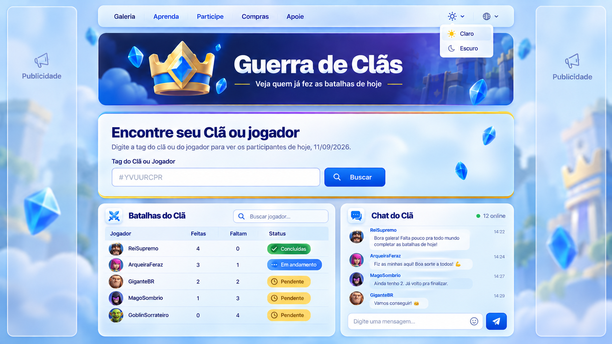

<div align="center">

[](README.md)
[](README.en-us.md)
[](README.es-419.md)
[](README.zh-cn.md)

[](https://github.com/Andrehlb)
[](https://github.com/Andrehlb#contact)

</div>

# GC — 部落战

这是一个用于查询和跟踪《皇室战争》部落战成员参与情况的 Web 应用。后端使用 Node.js 和 Express，调用 Supercell 官方 API，并执行业务规则来处理部落战参与情况。

这个项目源于我所在部落的实际需求：简单、清晰地了解谁已经完成当天的战斗，以及谁还有未完成的战斗。

原有前端使用 HTML、CSS 和 JavaScript 开发，在使用 Next.js、React 和 TypeScript 逐步构建新界面期间仍然可用。迁移过程中不会将属于后端的职责转移到前端。

## 新界面原型

新界面的视觉构想和功能定义在代码实现之前完成，用于记录项目发展所采用的方向。

**构想和功能定义：** André Luiz Barbosa  
**原型版本：** 1  
**日期：** 2026年9月11日

该布局规划了公开的部落或玩家搜索、战斗跟踪、个人资料、部落聊天、浅色和深色主题、多语言支持，以及与功能区域隔离的广告空间。

部落和玩家搜索将独立于聊天功能。公开搜索无需注册或登录。聊天功能需要身份验证：用户账户必须关联经过验证的 `playerTag`，访问权限将与玩家当前所在的部落关联。



## 使用的技术与培养的技能


开发过程中应用并培养以下技能：

- 外部 API 集成；
- HTTP 请求与状态解读；
- 令牌身份验证；
- 使用 `async/await` 和 `fetch` 进行异步编程；
- 创建 REST 接口；
- 数据处理与转换；
- Routes、Controllers、Services 和 Repositories 之间的职责分离；
- React、Next.js、TypeScript 和 App Router；
- CSS Modules 与响应式设计；
- 界面无障碍；
- 前端数据筛选与展示；
- 使用环境变量进行配置；
- 使用 Git 和 GitHub 进行版本控制；
- 云基础设施的准备与运维。

## 项目目标

本系统帮助部落跟踪每位玩家的名称、已完成和剩余战斗次数、参与状态，以及 River Race 当前处于训练期还是战争期。

系统汇总并处理成员和 River Race 数据，通过 Web 界面展示结果，让用户无需直接解读 API 响应。

## 当前功能

- 查询当前部落战。
- 使用 `clanTag` 按部落标签进行动态搜索。
- 查询部落成员。
- 查询当前 River Race。
- 通过玩家标签匹配数据。
- 计算已完成和剩余战斗次数。
- 识别训练期或战争期。
- 按名称或标签筛选玩家。
- 展示玩家参与情况。
- 自愿通过 PIX 赞助的区域。
- 为前端提供 REST 接口。

## 开发中的新界面

新界面正在 `frontend/` 中使用 Next.js、React 和 TypeScript 构建。

已确定的决策：

- 使用 App Router 组织页面；
- 使用 CSS Modules 编写样式；
- 静态导出到 `frontend/out`；
- 打开页面时不得自动加载任何部落；
- 不得将虚构玩家显示为真实数据；
- 公开的部落或玩家搜索；
- 浅色和深色主题；
- 多语言支持；
- 无障碍与响应式设计，包括语义化 HTML、与字段正确关联的 label 标签、图片替代文本、完整的键盘导航与可见焦点、适当的对比度、不仅依赖颜色的错误/成功信息、减少动态效果支持、文本大小调整/缩放、在动态组件中按需使用 ARIA、清晰的错误消息、WCAG 标准以及 Lighthouse 验证；
- 提供可通过可视控件和键盘操作的手动高对比度选项；
- 未来可增加通过语音命令开启和关闭高对比度的补充功能，始终保留可视控件/键盘替代方式：语音命令绝不会成为唯一可用的操作方式；
- 如果添加视频、音频或多媒体内容，需提供字幕、文字稿，并在适用时提供 Libras（巴西手语）资源；
- 玩家个人资料；
- 未来需要身份验证的部落聊天；
- 与功能区域隔离的广告；
- 在新界面达到功能对等之前保留原有前端。

## 安装

环境要求：

- Node.js 18 或更高版本；
- npm；
- 有效的 Supercell API 令牌。

在项目根目录执行：

```bash
npm install
npm start
```

默认情况下，后端可通过以下地址访问：

```text
http://127.0.0.1:3000
```

新前端在 `frontend/` 内拥有独立的依赖和构建流程。

## 配置

在项目根目录创建 `.env` 文件。该文件保存本地配置，不应纳入版本控制。

```env
PORT=3000
HOST=127.0.0.1
APP_NAME=GC Guerra de Clãs
APP_CONTEXT=API
SUPERCELL_API_TOKEN=
CLAN_TAG=#YVUURCPR
```

- `PORT`：Express 服务器端口；默认值为 `3000`。
- `HOST`：服务器监听地址；默认值为 `127.0.0.1`。
- `APP_NAME`：应用名称；默认值为 `GC ⚔️ Guerra de Clãs`。
- `APP_CONTEXT`：备用 HTML 响应中显示的上下文；默认值为 `API`。
- `SUPERCELL_API_TOKEN`：后端向 Supercell API 进行身份验证时使用的令牌。
- `CLAN_TAG`：后端现有的配置。新界面不得使用此值在打开页面时自动加载部落。

`.env` 文件不得纳入版本控制，`SUPERCELL_API_TOKEN` 的值绝不能公开。在 Supercell 门户中创建的密钥还必须授权运行应用的机器的 IP 地址。

## 使用方法

在当前前端中：

1. 打开应用；
2. 输入部落标签；
3. 发起当前部落战查询；
4. 查看玩家列表及参与情况；
5. 如有需要，按名称或标签筛选玩家。

新的部落搜索会将 `clanTag` 发送到后端，并从 Supercell 请求更新的数据。

## 接口

### 当前部落战参与情况

```http
GET /war-members/current
GET /war-members/current?clanTag=%23YVUURCPR
GET /war-members/current?playerTag=%23PLAYER
```

- `clanTag` 用于选择要查询的部落。
- 省略 `clanTag` 时，后端保持当前配置的行为。
- `%23` 表示经过 URL 编码的 `#` 字符。
- `playerTag` 可用于通过接口查询或筛选玩家。

响应格式：

```json
{
  "clan": {
    "name": "部落名称",
    "tag": "#YVUURCPR"
  },
  "members": [
    {
      "tag": "#PLAYER",
      "name": "玩家",
      "battlesDone": 4,
      "battlesMissing": 0,
      "status": "✅ 已完成所有战斗"
    }
  ]
}
```

其他现有接口包括 `GET /health` 和 `GET /clans`。

## 业务规则

- 星期一、星期二和星期三为训练期。
- 星期四、星期五、星期六和星期日为战争期。
- 战争期间，每位玩家每天最多可以使用四个卡组。
- 系统计算 `battlesDone`、`battlesMissing` 和 `status` 文本。
- 训练期间不记录未完成的战争战斗。

示例：

```text
玩家          已完成   剩余   状态
SwordFish          4      0   ✅ 已完成所有战斗
Fernando           3      1   ⚠️ 剩余 1 场战斗
玩家 X             0      4   ⏳ 剩余 4 场战斗
```

## Supercell 集成

每次查询时，后端访问：

```http
GET /v1/clans/{clanTag}/members
GET /v1/clans/{clanTag}/currentriverrace
```

外部 API 使用令牌进行身份验证。repository 查询所需资源，service 通过玩家标签匹配数据，并将结果转换为前端使用的响应。外部访问对 HTTP 状态码 `401` 和 `403` 进行专门处理。

## 架构

当前后端：

```text
Frontend → Routes → Controllers → Services → Repositories → Supercell API
```

职责：

- `Frontend`：展示与用户交互；
- `Routes`：定义 HTTP 接口；
- `Controllers`：读取参数并构建 HTTP 响应；
- `Services`：业务规则与数据转换；
- `Repositories`：访问 Supercell API 和本地数据。

新界面保持这一职责分离：Next.js 将负责展示、交互、无障碍、响应式设计、主题和语言，而 Express 将继续负责查询、业务规则、数据处理以及与 Supercell API 的集成。

## 部落聊天 — 规划中的架构

聊天仍是未来功能，将与公开搜索分离。

已确定的规则：

- 部落和玩家搜索无需登录；
- 只有聊天等需要身份验证的功能才要求注册和登录；
- `playerTag` 可用于公开搜索，也可关联到用户账户；
- 后端必须验证 `playerTag` 并识别玩家当前所在的部落；
- 用户只能访问自己所属部落的聊天；
- 持续访问聊天的权限必须与部落当前成员构成保持一致；
- 玩家离开部落时，必须撤销相应访问权限；
- 身份验证、授权、会话、内容管理、存储和实时更新将在实现聊天后端之前确定。

## 在开发中负责任地使用 AI

我将人工智能作为分析、实现、审查、测试和文档编写的辅助工具，同时对技术决策和纳入项目的代码承担责任。

在接受 AI 生成的建议之前，我会审查其逻辑、架构、依赖、错误处理、安全性、对现有代码的影响以及适用的测试。我不会向 AI 工具提供密码、令牌、API 密钥、个人数据或其他项目机密。

目标是利用 AI 提高生产力和质量，而不取代对代码的理解、代码审查、测试或开发者的责任。

## 支持项目

如果本项目帮助你的部落跟踪战争参与情况，你可以通过捐助来维持网站运行并支持项目发展。捐助完全自愿，可通过应用内的捐助区域进行。

## 部署

生产架构使用 Oracle Cloud Infrastructure 和 Nginx。新前端已为静态导出到 `frontend/out` 做好准备，Express 后端继续作为负责 API 和业务规则的服务。

公开访问信息只有在发布流程中完成验证后，才能记录在此处。

## 当前状态与后续步骤

新界面开发中已完成：

- 对之前的本地更改进行安全验证/同步及完整性检查/审查；
- 移除界面中的部落自动加载；
- 确定使用 Next.js、React、TypeScript 和 CSS Modules 的架构；
- 在 `frontend/` 中创建 Next.js 应用；
- 通过 ESLint 和构建验证；
- 配置静态导出到 `frontend/out`；
- 定义并记录第 1 版视觉原型；
- 确定主要视觉资源：皇冠、页眉场景和浅色背景；
- 5.2 保存并检查图片：已完成。
- 5.3 检查并优化文件：已完成；
- 已将主要资源的 PNG 和 WebP 版本添加到项目中；
- 6.1 构建新界面的主要区域结构：已完成；
- 主要区域的宽度已调整为最大 `1120px`；
- 已实现 `main → content → section` 结构；
- 已通过 `npm run lint` 和 `npm run build` 完成本步骤的最终验证。

当前步骤：

```text
第 6 阶段 — 使用 React 构建界面
└── 6.2 应用新界面的整体背景
```

主要视觉资源已位于 `frontend/public/assets/`：

```text
frontend/public/assets/crown-royale-original.png
frontend/public/assets/crown-royale-original.webp
frontend/public/assets/royale-arena-hero.png
frontend/public/assets/royale-arena-hero.webp
frontend/public/assets/royale-page-background-light.png
frontend/public/assets/royale-page-background-light.webp
```

下一步将使用已准备并验证的资源应用界面整体背景，同时保持响应式设计、无障碍以及结构与展示的分离。

## 贡献

可以通过 issue 或 pull request 提交建议和修复。请勿包含令牌、`.env` 文件或其他凭据。

