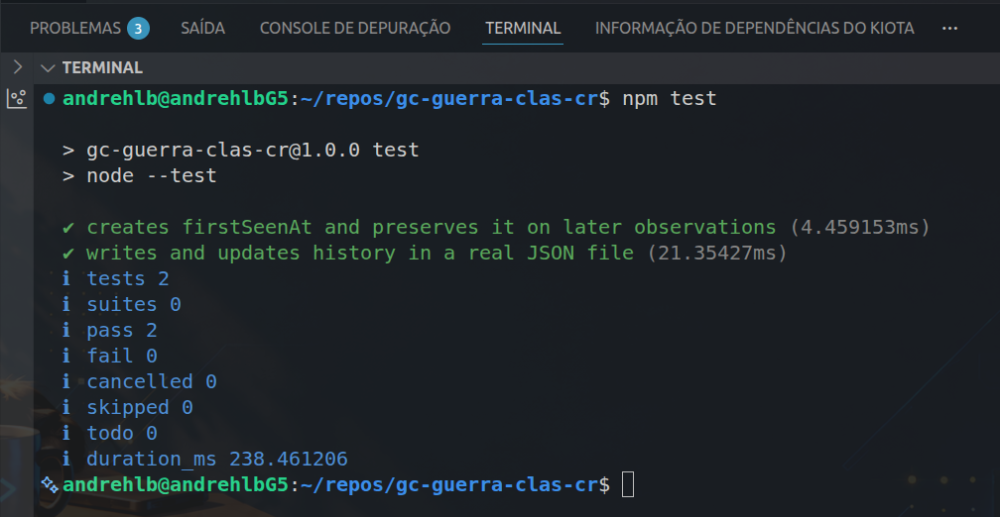

# QA & Testing — Clash Royale: Guerra de Clãs

## 1. Objetivo

Documentar as atividades de Quality Assurance (QA)
e testes de software realizadas no projeto
Clash Royale: Guerra de Clãs.

O objetivo é demonstrar a realização de testes funcionais, exploratórios, automatizados, de integração e regressão, com resultados
rastreáveis e evidências publicadas no GitHub.

## 2. Testes automatizados existentes

O projeto usa Node.js e node:test para
executar testes automatizados.

Atualmente, existem dois testes de persistência
de dados, ambos aprovados na execução documentada
em 11/10/2026.

**Relatório de execução:**

[Consultar relatório dos testes TC-001 e TC-002 — Testes de persistência de membros e histórico JSON](2026-10-11-8af31ae.md)

**Evidência visual:**

**Figura 1 —** Resultado da execução dos testes automatizados de persistência de dados no projeto Guerra de Clãs, usando Node.js (`node:test`). Aprovados 2 testes sem falhas. (Fonte: Elaborado pelo autor, 2026).
